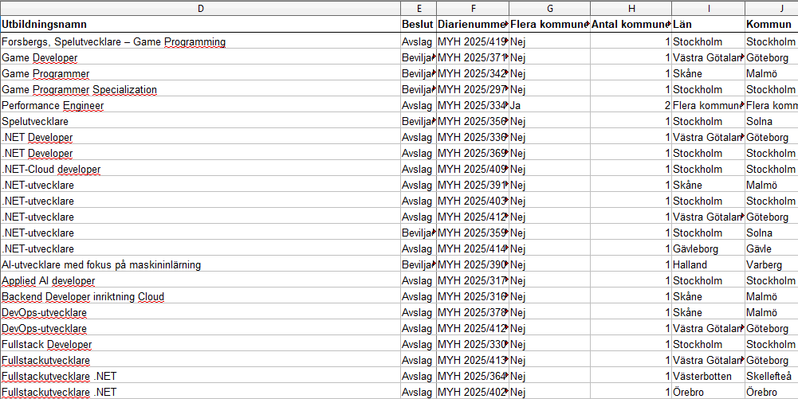
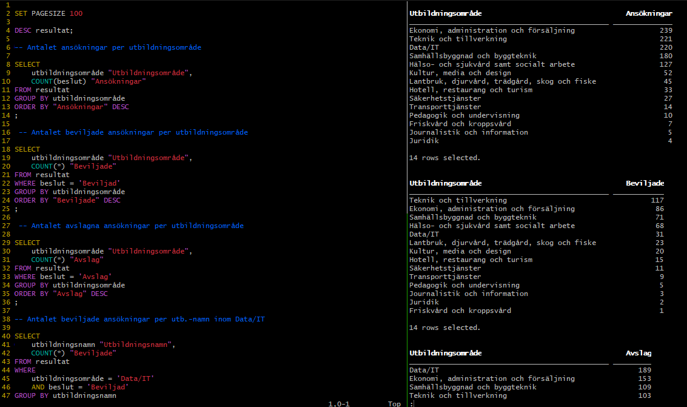

The Skool

I det här projektet har jag filtrerat och sammanfattat data som kan tänkas vara relevant
för att kunna fatta bra datadrivna beslut vid ansökan och uppstart för en helt ny 
utbildningsanordnare; The Skool. 

Informationen har hämtats från ett excelblad som innehåller Yrkeshögskolans resultat för ansökningsomgången 2025,
därefter har jag sammanställt och listat datan med hjälp av script i Oracle SQLcl, baserat på
ett antal olika frågeställningar inom området.

 

 
